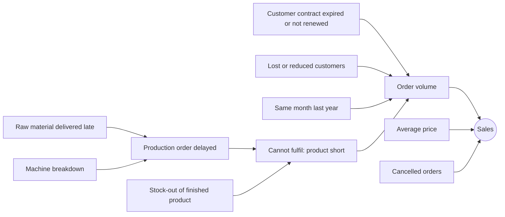

# AI analysis: answering "why" questions

Status: design, 2026-10-31. Mock data comes from butterfly phase 08. Nothing here is built in synapse-api or sami-agents yet.

## 1. What management asks

| Level | Example | What it needs | Status |
|-------|---------|---------------|--------|
| 1. Show me | "show me sales and top customers" | pick widgets | done (`sami-agents` keyword search) |
| 2. Tell me | "What are the sales for August?" | metric and period from the question, a real figure, a sentence, a trend chart | next |
| 3. Why | "Why did sales drop in August?" | decide which factors could explain it, check each against data, rank by effect, explain with evidence | this document |

A level 3 answer looks like: "Sales fell 12% from July to August (₹X to ₹Y). 54% of the fall came from Acme Industries, whose sales contract ended on 12 July and had not been renewed. 31% came from Steel plate 5mm: Doosan Metals delivered Steel coil 12 days late (promised 14 July, delivered 26 July), which delayed production order 0001000417 by 14 days. The rest, 15%, is not explained by the data we hold."

## 2. Principles

1. **Code finds facts, a model never invents them.** Every figure, date and name in an answer comes from a query result. A model may help choose which checks to run and may polish wording, but a check rejects any name, number or date that is not in the findings.
2. **Say what the data shows.** Findings are "coincided with" and "contributed to", not proof of cause. Each finding lists its evidence (document numbers, dates, amounts), and the answer ends with how much of the change is explained and how much is not.
3. **Use the user's own access.** Every check runs with the signed-in user's session, so the answer only contains what that person may see.
4. **Mock data is labelled.** While the data comes from butterfly the answer says so.

## 3. The driver graph

The agent needs to know, for a subject such as sales, which other things can move it and how to check each one. That knowledge is a graph, kept as data in `sami-agents` (not in a prompt), so it can be read, tested and extended one factor at a time.

- A **node** is a metric or a factor ("Sales", "Customer contract", "Production delay", "Supplier delivery delay").
- An **edge** says "this factor can move that one". It names the **check** that tests it (a synapse-api call), the **evidence** the check returns, and the **condition** that makes it relevant (for example "only for customers whose sales fell").

How a "why did sales drop" question walks it:

1. **Resolve** metric (sales), period (August 2026) and comparison (previous month by default; "year on year" if asked).
2. **Measure and split** the change: total, then by customer and by material. This uses data we already have and decides where to look.
3. **Follow the graph** from the biggest contributors:
   - a customer whose sales fell: check its **contract** (ended in the window? renewed? gap?);
   - a material whose sales fell: check **production orders** for it (delayed? reason?), then the **components** of those orders, then the **purchase deliveries** of those components (late? which supplier? how many days?);
   - cancelled orders and price changes are checked from the sales data itself.
4. **Rank** findings by the amount of the change each explains; the rest is "not explained".
5. **Write** the answer from the findings with a template (a model may rephrase), with a chart of the monthly trend and a table of the evidence.
6. **Validate** that nothing in the text is missing from the findings.

A factor is only added to the graph when its data exists. Today we have the first three rows below; the others need SAP views.

| Factor | How it moves sales | Check | Source (SAP) | Status |
|--------|-------------------|-------|--------------|--------|
| Customer change | fewer or smaller orders from one customer | sales by customer, period against comparison | sales summaries | have |
| Material change | less of one product sold | sales by material | sales summaries | have |
| Cancelled orders | sales taken back | orders with status `X` | sales orders | have |
| Customer contract | contract ended or not renewed, orders stop | contracts for the falling customers, validity against the window | sales contracts (`VBAK`, `VBAP`, `VEDA`) | butterfly 08 mock, SAP view needed |
| Production delay | product not made in time, orders not taken | production orders for the falling materials, planned against actual end, delay reason | production orders (`AFKO`, `AFPO`) | butterfly 08 mock, SAP view needed |
| Component shortage | production waits for material | components of the delayed orders | reservations (`RESB`) | butterfly 08 mock, SAP view needed |
| Supplier delay | raw material arrives late | deliveries of those components, promised against actual date | purchase orders and goods receipt history (`EKKO`, `EKPO`, `EKET`, `EKBE`) | butterfly 08 mock, SAP view needed |
| Price change | same volume, lower value | average price per unit by material | sales items | possible later |
| Stock-out, quality, credit blocks, seasonality | various | later | later | not scheduled |

The SAP table names are the usual sources and must be confirmed by the SAP consultant.

## 4. Where each part lives

| Part | App | Notes |
|------|-----|-------|
| Contract for the new data | `docs/sap/drivers-contract.md` | source of truth for butterfly, synapse-api and the SAP consultant |
| Mock SAP data with a built-in story | `butterfly` phase 08 | 14 months of sales plus contracts, deliveries, production orders |
| Fact tools (decompose a change, contracts, deliveries, production) | `synapse-api` | read-only endpoints on the user's session; cached 5 minutes like the others |
| The driver graph, the walk, ranking, the answer text, validation | `sami-agents` | LangGraph is the walker: plan, run checks in parallel, rank, write, validate |
| Question understanding (metric, period) | `sami-agents` | rules first; a model only if it measures better |
| Showing the answer (text, chart, evidence table) | `synapse-web` | JSON blocks drawn with the existing widgets |
| SAP views for the new entities | SAP team | from the contract; new work for them |

## 5. The model's role and its limits

- Understanding a question ("sales", "August", "why") and choosing checks is a small job. Rules cover most of it; a small model can be tested against the evaluation set.
- Turning a ranked findings list into a good paragraph is easy with a template and a better paragraph needs a stronger model. The small models in our Ollama (up to 3B) invent details when asked to write freely, so they must only rephrase and be validated.
- A local-only deployment limits quality. Using a hosted model sends business data off the machine; that is a management and security decision, not a technical one. The design works without a model at all.

## 6. How we will know it works

The mock data has a known story (section 7) so every answer can be checked against the truth: which factors must appear, which must not, and the order. The evaluation set holds "why" questions with expected findings; a run reports found, missed and invented factors. Real past drops with known causes, from management, replace the mock story when the SAP views exist.

## 7. The mock story (butterfly 08)

"Why did sales drop in August 2026?" The data is built so the correct answer is:

| Factor | What the data says |
|--------|-------------------|
| Customer contract | Acme Industries (the largest customer, about a quarter of sales) has contract `0040000127`, valid until 2026-07-12. It was not renewed until 2026-09-14, so its orders fall away from mid July to mid September |
| Supplier delay | Doosan Metals delivered Steel coil on purchase order `4500001207` on 2026-07-26 against a promised 2026-07-14 (12 days late) |
| Production delay | The production order for Steel plate 5mm (`0001000417`) planned to finish 2026-07-20 finished 2026-08-03, reason material shortage |
| Effect | orders for Steel plate 5mm fall in late July and August |
| Noise | other customers and materials move by normal amounts; one other delivery is a few days late and has no effect on sales; a machine breakdown on an unrelated product (Bearing 6204, production order `0001000388`) did not reduce its sales |

The last two rows are there so the agent is tested on not blaming everything it finds.

## 8. Phases

| Phase | What | Needs |
|-------|------|-------|
| butterfly 08 driver-data | the contract, the entities and the story data | this document |
| synapse-api 07 sales-change | decompose a change by customer and material; level 2 facts for one month | butterfly 08 |
| synapse-api 08 driver-facts | contracts, production orders, components and deliveries as read endpoints | butterfly 08 |
| sami-agents 03 answer-questions | level 2: metric and period, sentence with figure, chart | synapse-api 07 |
| sami-agents 04 driver-graph | level 3: the graph, the walk, ranking, validated answer | synapse-api 08, sami-agents 03 |
| synapse-web 12 ai-answers | AI Mode shows text, chart and evidence | sami-agents 03 |
| SAP team | RAP views for the four entities (see the contract) | `docs/sap/drivers-contract.md` |

## 9. Risks

- **Correlation is not cause.** A contract that ended on the day a customer stopped ordering is a strong hint, not proof. The wording and the evidence list say so.
- **Data quality.** Delivery dates, production confirmations and contract validity in the real system may be incomplete or entered late. The agent reports what it cannot check.
- **Too many findings.** Every real month has late deliveries. Findings are ranked by the amount of the change they explain and anything below a small share is left out.
- **Performance.** A "why" question makes several calls; they run in parallel and use the 5-minute cache, and the answer has a time limit with a partial result.
- **Authorisation.** SAP sees one shared login for management users, so the app, not SAP, must keep a user to the data their role allows.
